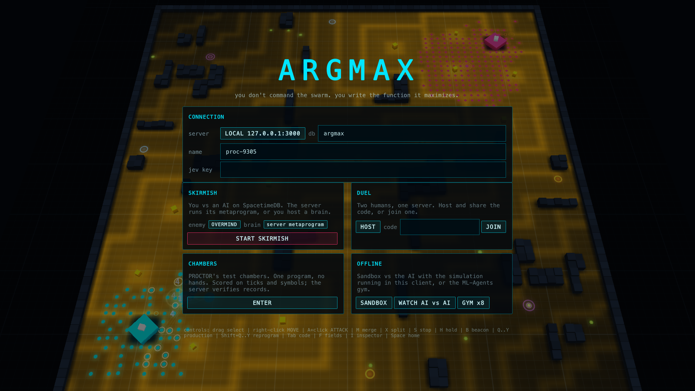
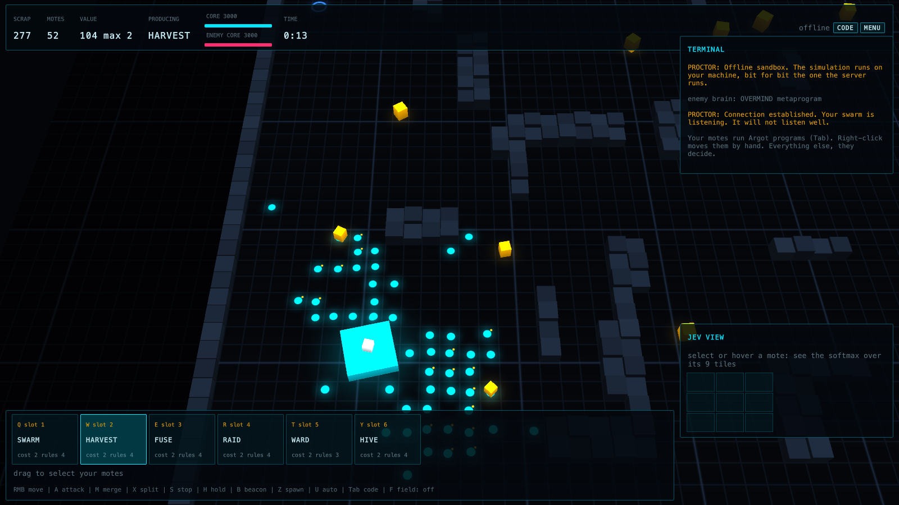
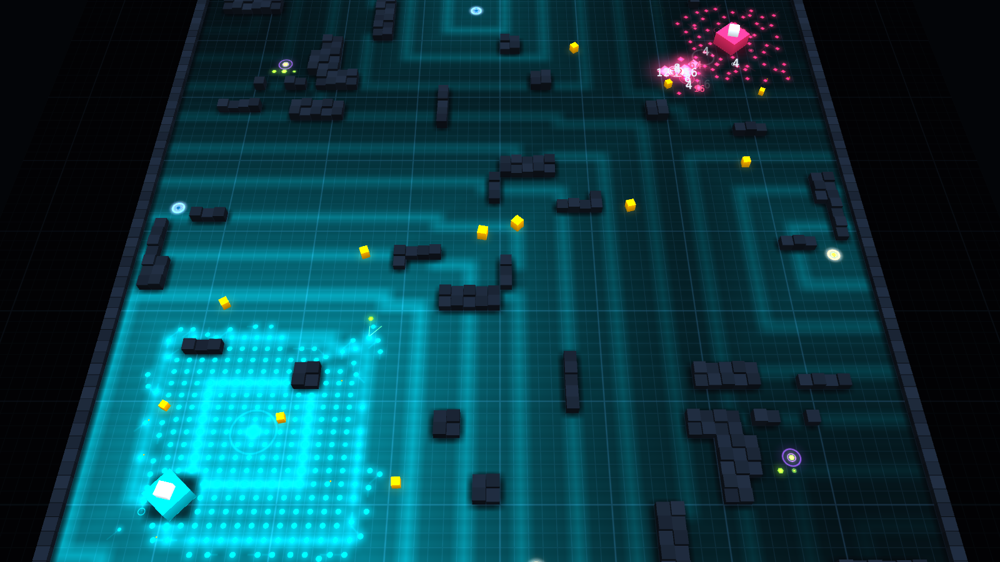
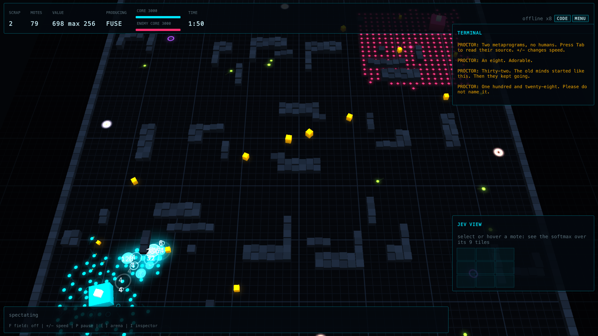
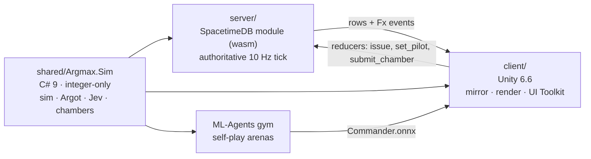

<div align="center">

# ARGMAX

**A swarm-programming RTS for the dead internet.**<br>
You don't command the swarm. You write the function it maximizes.

[**Whitepaper**](https://waltergropius.github.io/argmax/) · [Design doc](docs/DESIGN.md) · [Quick start](#quick-start) · [How it works](#how-it-works)


<sub>TURTLE's fused 512s and 256s (pink) cut through OVERMIND's checkerboard of 2s (cyan). Recorded from the deterministic simulation, AI vs AI.</sub>

</div>

---

Every unit, every tick, answers one question: *which of these nine tiles?* It takes a softmax over features of
its 5×5 surroundings and the world's gradient fields, and **your program supplies the weights**. Units are worth
2, 4, 8 … 2048 and fuse like 2048 tiles. The server is SpacetimeDB. Your opponents are Argot metaprograms, an
ML-Agents policy trained by self-play, or TypeSafe's Jev answering typed questions about the battlefield.

<table>
<tr>
<td width="50%"><br><sub><b>The menu</b> runs a live AI-vs-AI battle behind a terminal UI.</sub></td>
<td width="50%"><br><sub><b>Your swarm</b> running <code>HARVEST</code>: <code>spread</code> keeps it in a splash-proof checkerboard.</sub></td>
</tr>
<tr>
<td><br><sub><b>Gradient fields</b> (key <code>F</code>): units read these instead of path-searching.</sub></td>
<td><br><sub><b>2048 fusion</b>: a FUSE army merges up to 256 while PROCTOR comments.</sub></td>
</tr>
</table>

## Write the swarm

Press **Tab** in a match. Each line is a rule: a conjunction of sensors and one action. Matching rules add their
weights.

```text
@name PINCER
when order: seek order 3
when enemy and not outnumbered: seek enemy 2
when hurt: split
when pair and not enemy: merge 2
always: flock
```

- **20 sensors:** `enemy contact allies crowded hurt carrying full order scrap home pair beacon outnumbered big siege clock trail lonely wild tiny`
- **Actions:** `seek / avoid <order enemy scrap home beacon core allies trail>`, `flock`, `spread`, `form <checker rows cols grid diag>`, `merge`, `split`, `mine`, `hold`, `wander`, `infect`, `mark`, `holdfire`
- **`@meta` programs** steer your whole side once per second (`produce`, `spawn`, `beacon`, `army`). The default AI, OVERMIND, is ten readable lines.
- Every rule past four costs +1 scrap per unit. Short programs make cheaper armies.

## Features

| | |
|---|---|
| **System-1 movement** | No pathfinding. A Jev-style typed choice over 9 tiles, scored on 13 integer features; the inspector shows each unit's softmax live |
| **2048 fusion** | Equal values fuse, splitting is free. A held 2048 Singularity wins |
| **Coherence** | Isolated units decohere; embedded ones repair (a Markov blanket) |
| **Stigmergy, portals, the Noise** | Units write trails; gradients flow through portals; feral programs spawn from wells, and `infect` rewrites them |
| **Four commanders** | Argot metaprograms, an ML-Agents policy, Jev and humans all emit the same `MetaDecision` |
| **Test chambers** | Five PROCTOR puzzles scored on ticks and symbols, verified server-side by re-simulation |
| **Modes** | Skirmish, duel (4-letter codes), chambers, spectate, sandbox, and the ML gym (watch or train) |

## Quick start

You need the SpacetimeDB CLI 2.10+, the .NET 8 SDK with the `wasi-experimental` workload, Unity 6000.6, and
[uv](https://docs.astral.sh/uv/) (only for training).

```bash
git clone https://github.com/WalterGropius/argmax && cd argmax
scripts/local.sh
```

`local.sh` starts a local SpacetimeDB, publishes the module as `argmax`, and regenerates the client bindings.
Then open `client/` in Unity 6.6 and press **Play** in any scene; there's no scene setup.

- **SKIRMISH** plays you against OVERMIND on the local server. Set *server* to MAINCLOUD for online.
- **DUEL** → HOST shows a code, the other player JOINs with it.
- **CHAMBERS / SANDBOX / WATCH AI vs AI / GYM** run without a server.

**Controls:** drag to select · right-click **move** (manual override) · **A**+click **attack** (the program
decides how) · **M** merge · **X** split · **S** stop · **H** hold · **B** beacon · **Q–Y** production slot ·
**Shift+Q–Y** reprogram · **Ctrl+1–9** groups · **Tab** code · **F** fields · **I** inspector · **Space** home.

## How it works



The same simulation source compiles into the server, the client and the gym, with no port to drift. The tests
assert **identical state hashes** on native .NET, Unity's Mono, and SpacetimeDB both locally and on maincloud.
The server keeps each live match hot in memory, validated against its row, and writes only diffs. The 10 Hz
heartbeat runs only while a match is live. Details and measurements are in the
[whitepaper](https://waltergropius.github.io/argmax/).

| path | what |
|---|---|
| [`shared/Argmax.Sim/`](shared/Argmax.Sim/Runtime) | the game: simulation, Argot compiler, Jev classifier, chambers, commander observations (a Unity package, also compiled into the server and tools) |
| [`server/`](server/Lib.cs) | SpacetimeDB 2.10 C# module: tables, reducers, scheduled tick, chamber verification |
| [`client/`](client/Assets/Argmax/Scripts) | Unity project: instanced renderer, UI Toolkit, input, SpacetimeDB client, gym, Jev and ML pilots |
| [`tests/`](tests/Argmax.Sim.Tests) | .NET tests pinned to C# 9 so the shared code stays Unity-compatible |
| [`tools/Arena/`](tools/Arena/Program.cs) | headless tournaments (balance), Jev vs AI over the live API, a highlight finder |
| [`ml/`](ml/README.md) | trainer config and setup |
| [`scripts/`](scripts) | local server, maincloud publish, bindings, tests, determinism smoke, training |

## Online

The server is published on maincloud as **`argmax-deadnet`**. To republish your changes:

```bash
scripts/publish-maincloud.sh
```

## Tests

```bash
scripts/test.sh
```

This runs the simulation tests, Unity EditMode tests asserting the same golden hashes, and a deterministic server
match on local SpacetimeDB. `scripts/smoke.sh maincloud` checks the live database the same way.

## AI opponents

- **Metaprograms:** OVERMIND, TURTLE, LOCUST and ASSEMBLER run inside the server. Write your own with `@meta`.
- **ML-Agents:** run `ml/setup.sh`, then `scripts/train.sh argmax-v2 60`. That trains headless and installs
  `Commander.onnx` into the client. Pick *brain: ML-Agents* in the skirmish card. See [ml/README.md](ml/README.md).
- **Jev:** add your key in the menu, as `JEV_API_KEY`, or in a gitignored `.env.local`, then pick *brain: JEV*.
  To run it headless: `dotnet run --project tools/Arena -- jev OVERMIND`.

## Influences

StarCraft II · 2048 · Boids · Turing Complete · SpaceChem · Replicube · The Farmer Was Replaced · Portal 2 · Uplink
· AI Warehouse · BitCraft · TypeSafe Jev. Ideas from the author's Laifea notes include *serendipity over search*,
Lilly's metaprogramming, the Free Energy Principle, Assembly Theory, turmites, and the dead internet.

<sub>Built with Claude Code. Every image here was rendered from the game's deterministic simulation.</sub>
