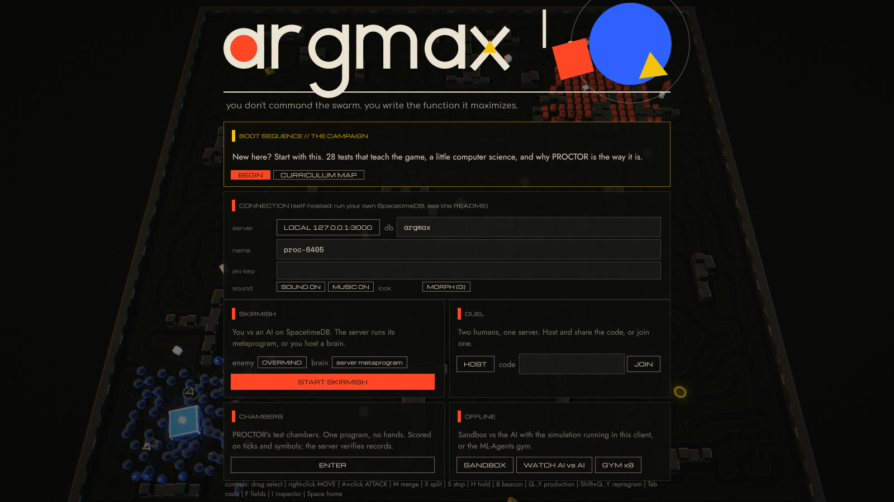
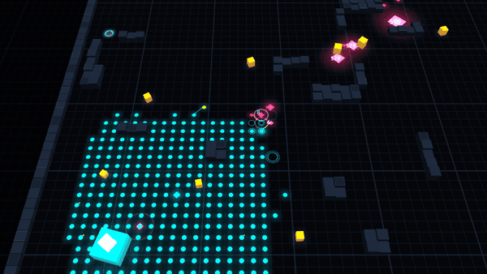
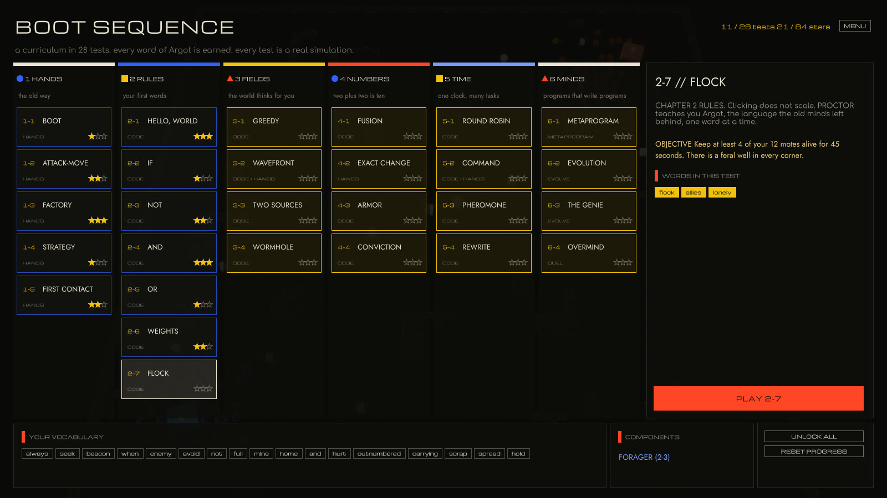
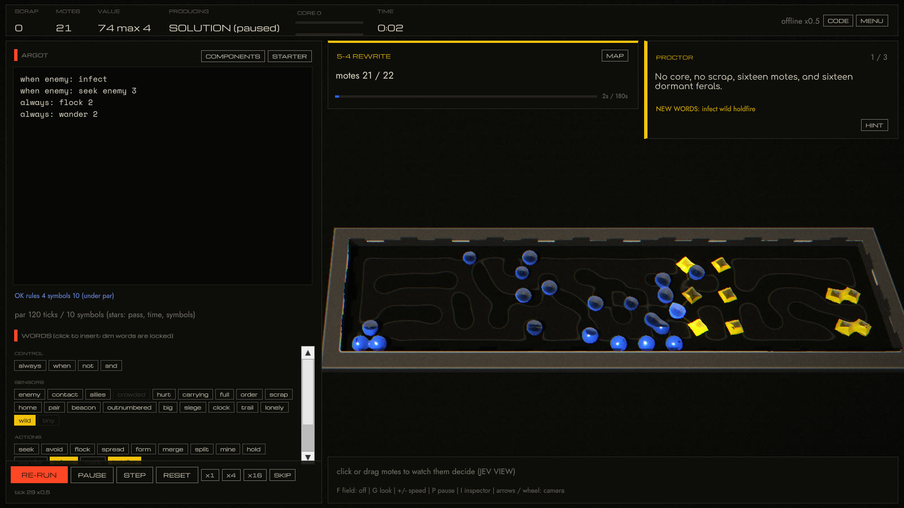
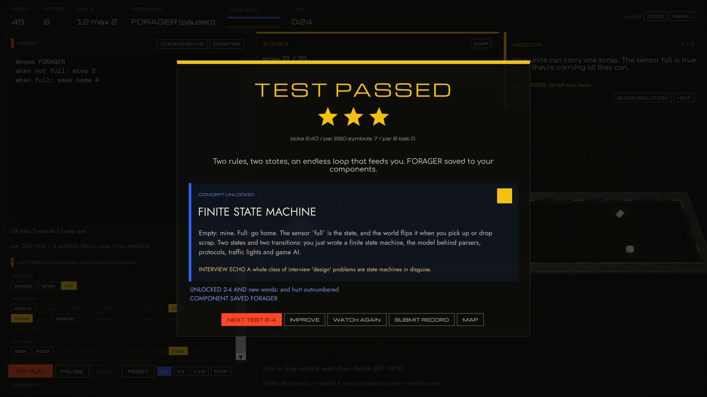
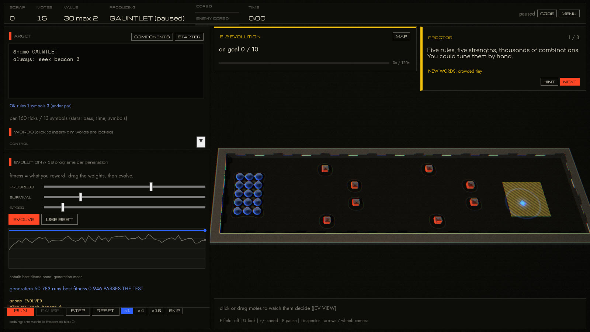
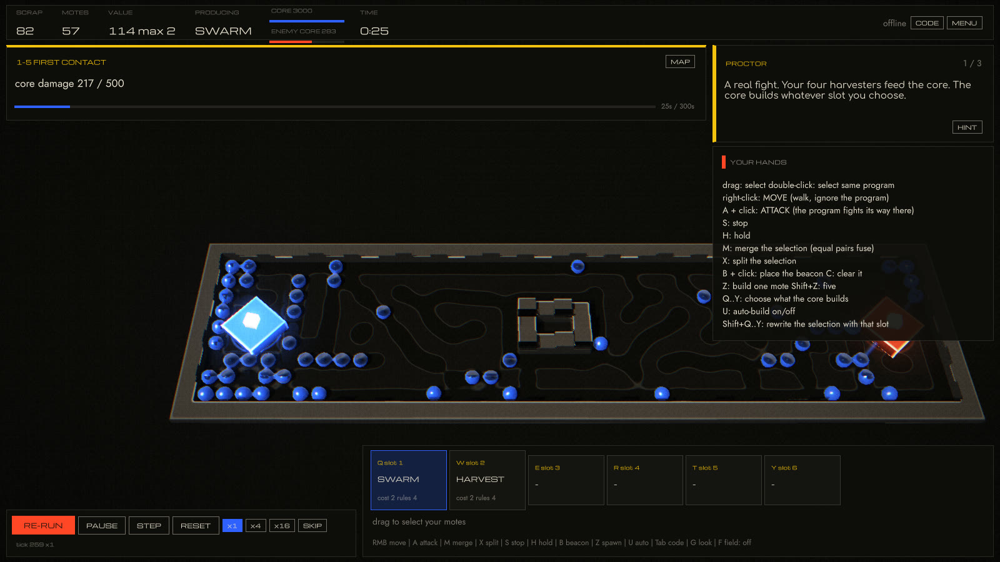
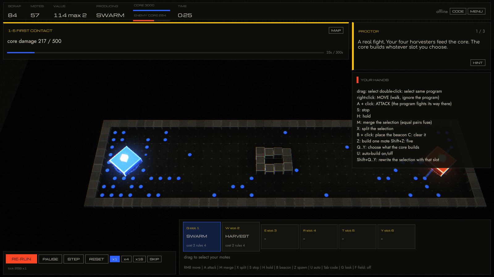
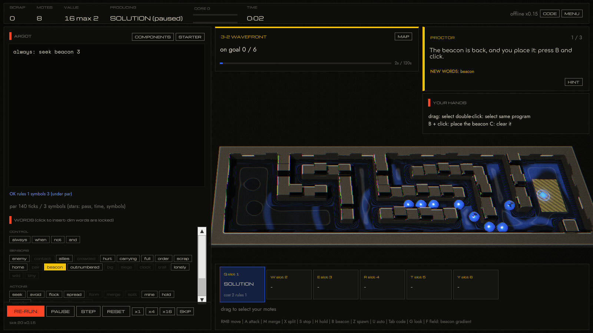

<div align="center">

# ARGMAX

**A swarm-programming RTS for the dead internet.**<br>
You don't command the swarm. You write the function it maximizes.

[**▶ Play in your browser**](https://waltergropius.github.io/argmax/play/) · [**Download**](https://github.com/WalterGropius/argmax/releases/latest) · [Whitepaper](https://waltergropius.github.io/argmax/) · [Self-host](docs/SELFHOST.md) · [Design doc](docs/DESIGN.md)






<sub>Two metaprograms fight, rendered in MORPH mode. Every frame is the deterministic simulation the server runs.</sub>

</div>

---

Every unit, every tick, answers one question: *which of these nine tiles?* It takes a softmax over features of
its 5×5 surroundings and the world's gradient fields, and **your program supplies the weights**. Units are worth
2, 4, 8 … 2048 and fuse like 2048 tiles. Your opponents are Argot metaprograms, an ML-Agents policy trained by
self-play, TypeSafe's Jev answering typed questions about the battlefield, or another human on a SpacetimeDB
server you host yourself.

## BOOT SEQUENCE: the campaign

New players start with a mouse and three dots. Twenty-eight tests later they beat OVERMIND without touching
anything. In between, the campaign hands out the game the way Turing Complete hands out logic gates: **you
earn every word of Argot by using it**, and the editor refuses words you haven't been taught yet.

<table>
<tr>
<td width="50%"><br><sub><b>The curriculum.</b> Six chapters: HANDS, RULES, FIELDS, NUMBERS, TIME, MINDS.</sub></td>
<td width="50%"><br><sub><b>A test.</b> Write a rule, press RUN, watch every mote run it. Click a word to insert it; dim words are locked.</sub></td>
</tr>
<tr>
<td><br><sub><b>Pass, get a concept.</b> Two rules and two states make a finite state machine, and that's the card you get for it, with the LeetCode problems it quietly prepares you for.</sub></td>
<td><br><sub><b>Evolve it.</b> A genetic algorithm searches rule strengths while you choose the reward. Then 6-3 shows you what a bad reward does.</sub></td>
</tr>
</table>

Each test teaches one mechanic and one computer-science idea, and is scored like a Zachtronics puzzle (pass,
par time, par symbols). The test suite plays every level's reference solution and checks that its starter
code *doesn't* already pass.

<details>
<summary><b>The syllabus</b> (all 28 tests, with the interview problems each one rhymes with)</summary>

| test | title | kind | new words | concept | interview echo |
|---|---|---|---|---|---|
| 1-1 | BOOT | hands |  | THE TICK | Updating everything from one snapshot is double buffering. Get it wrong in LeetCode 289 'Game of Life' and cells read their neighbours' future. |
| 1-2 | ATTACK-MOVE | hands |  | IMPERATIVE vs DECLARATIVE |  |
| 1-3 | FACTORY | hands |  | VALUE IS COST | Invariants are how you prove an algorithm correct: state one before the loop, keep it true inside, and the interviewer is half convinced. |
| 1-4 | STRATEGY | hands |  | STRATEGY PATTERN | System design interviews love this one: inject the behaviour instead of subclassing it. |
| 1-5 | FIRST CONTACT | hands |  | FEEDBACK LOOPS | Spotting the loop is a skill: LeetCode 202 'Happy Number' and 141 'Linked List Cycle' are about noticing when a process feeds itself. |
| 2-1 | HELLO, WORLD | code | `always seek beacon` | A PROGRAM IS A FUNCTION | map, filter, reduce: a surprising share of array problems are one of the three in disguise. |
| 2-2 | IF | code | `when enemy avoid` | CONDITIONALS | Guard clauses and early returns: branch on state first, and the rest of the function gets simpler. |
| 2-3 | NOT | code | `not full mine home` | FINITE STATE MACHINE | A whole class of interview 'design' problems are state machines in disguise. |
| 2-4 | AND | code | `and hurt outnumbered` | BOOLEAN AND | Bit-manipulation problems (LeetCode 136 'Single Number', 191) are truth tables in disguise. |
| 2-5 | OR | code | `carrying scrap` | OR IS TWO RULES | De Morgan's law turns `!(a && b)` into `!a or !b`. Clean boolean rewrites read well in any code review. |
| 2-6 | WEIGHTS | code | `spread hold` | THE WEIGHTED SUM | A dot product is the inner loop of every ML question: LeetCode 1570 'Dot Product of Two Sparse Vectors'. |
| 2-7 | FLOCK | code | `flock allies lonely` | EMERGENCE | Flocks are connected components: LeetCode 200 'Number of Islands' counts them with the same BFS you'll meet in chapter 3. |
| 3-1 | GREEDY | code | `order wander` | GREEDY ALGORITHMS | LeetCode 55 'Jump Game' rewards greedy. 45 'Jump Game II' and every shortest-path problem punish naive greed. |
| 3-2 | WAVEFRONT | code + hands | `beacon` | BREADTH-FIRST SEARCH | LeetCode 1091 'Shortest Path in Binary Matrix' is this exact 8-direction BFS. |
| 3-3 | TWO SOURCES | code |  | MULTI-SOURCE BFS | LeetCode 542 '01 Matrix', 994 'Rotting Oranges' and 286 'Walls and Gates' are all this algorithm. |
| 3-4 | WORMHOLE | code |  | GRIDS ARE GRAPHS | LeetCode 1345 'Jump Game IV' and every teleporter variant: change the edges, keep the BFS. |
| 4-1 | FUSION | code | `merge pair` | BINARY CARRY | LeetCode 67 'Add Binary', 231 'Power of Two', 1046 'Last Stone Weight'. |
| 4-2 | EXACT CHANGE | hands | `split` | BINARY | LeetCode 191 'Number of 1 Bits', 338 'Counting Bits', 1342 'Number of Steps to Reduce a Number to Zero'. |
| 4-3 | ARMOR | code | `big contact form checker rows cols grid diag` | COST PER OPERATION | Big-O hides constants. Ask how expensive each step is before asking how many steps there are. |
| 4-4 | CONVICTION | code | `core siege` | BATCHING | LeetCode 1011 'Capacity To Ship Packages Within D Days' is batching plus binary search. |
| 5-1 | ROUND ROBIN | code | `clock` | TIME-SLICING | LeetCode 621 'Task Scheduler' is round-robin with cooldowns. |
| 5-2 | COMMAND | code + hands |  | COMMAND PATTERN | Undo and redo stacks (LeetCode 1472 'Design Browser History') are the Command pattern. |
| 5-3 | PHEROMONE | code | `mark trail` | STIGMERGY | Shared state vs message passing is a classic concurrency design question. |
| 5-4 | REWRITE | code | `infect wild holdfire` | CODE IS DATA | LeetCode 150 'Evaluate Reverse Polish Notation': a program is data you interpret with a stack. |
| 6-1 | METAPROGRAM | @meta | `@meta produce spawn army attack retreat front workers rich poor threat ahead` | HIGHER-ORDER PROGRAMS | Functions that take or return functions: closures, decorators, LeetCode 2629 'Function Composition'. |
| 6-2 | EVOLUTION | evolve | `crowded tiny` | GENETIC ALGORITHMS | When exhaustive search explodes (2^n subsets), prune, approximate or sample. Local search is fair game when brute force isn't. |
| 6-3 | THE GENIE | evolve |  | REWARD HACKING | Clarify the objective before you optimise. Half of all wrong answers solve the wrong problem. |
| 6-4 | OVERMIND | duel |  | YOU | The meta-skill: act, get scored, adjust. It's how you got good at this, and how you'll get good at the next thing. |

</details>

## The look: MORPHOGENESIS

Bauhaus geometry meets morphogenesis. The palette is warm ink and bone with the three primaries, assigned the
way Kandinsky assigned them: **you are cobalt circles, whoever you fight is vermilion squares, the Noise is
chrome-yellow triangles.** The logotype isn't set in a font. Like Herbert Bayer's universal alphabet, it's built
from circles, arcs and bars.

<table>
<tr>
<td width="50%"><br><sub><b>MORPH</b> (default, key <code>G</code>). The world is raymarched signed distance fields. Allies smooth-union into one organic mass, so 2048 fusion is literally two blobs melting together. The grid only survives in where things are, and the floor grows Gray-Scott Turing patterns seeded by the swarms.</sub></td>
<td width="50%"><br><sub><b>GRID.</b> The same world as flat Bauhaus shapes with cut-paper shadows and Kandinsky rings that multiply as values grow, over an ink floor whose grid is reduced to registration crosses. It's also lighter for older GPUs.</sub></td>
</tr>
<tr>
<td colspan="2"><br><sub><b>Fields as water.</b> Press <code>F</code> and the gradient a program follows becomes ripples flowing toward their source, after Theodor Schwenk's <i>Sensitive Chaos</i>. The BFS distance field is the water.</sub></td>
</tr>
</table>

Type by role: **Michroma** for labels and numbers, **Jost** for reading, **Comfortaa** for PROCTOR's voice, and
**Space Mono** for code, all SIL OFL and bundled. Futura and Alte Haas Grotesk take over automatically if they're
installed on your system. The finish is a small print pipeline: highlights roll off softly, the color plates sit a
hair out of register like a risograph, and there's paper grain.

## Write the swarm

Press **Tab** in a match. Each line is a rule: a conjunction of sensors and one action. Matching rules add their
weights.

```text
@name PINCER
when order: seek order 3
when enemy and not outnumbered: seek enemy 2
when hurt: split
when pair and not enemy: merge 2
always: flock
```

- **20 sensors:** `enemy contact allies crowded hurt carrying full order scrap home pair beacon outnumbered big siege clock trail lonely wild tiny`
- **Actions:** `seek / avoid <order enemy scrap home beacon core allies trail>`, `flock`, `spread`, `form <checker rows cols grid diag>`, `merge`, `split`, `mine`, `hold`, `wander`, `infect`, `mark`, `holdfire`
- **`@meta` programs** steer your whole side once per second (`produce`, `spawn`, `beacon`, `army`). The default AI, OVERMIND, is ten readable lines.
- Every rule past four costs +1 scrap per unit. Short programs make cheaper armies.

## Features

| | |
|---|---|
| **Campaign** | 28 tests, six chapters, PROCTOR's narration, concept cards, a word-gated editor, stars, components you keep, an evolution lab and an epilogue that plots your learning curve |
| **System-1 movement** | No pathfinding. A Jev-style typed choice over 9 tiles, scored on 13 integer features; the inspector shows each unit's softmax live |
| **2048 fusion** | Equal values fuse, splitting is free. A held 2048 Singularity wins |
| **Coherence** | Isolated units decohere; embedded ones repair (a Markov blanket) |
| **Stigmergy, portals, the Noise** | Units write trails; gradients flow through portals; feral programs spawn from wells, and `infect` rewrites them |
| **Four commanders** | Argot metaprograms, an ML-Agents policy, Jev and humans all emit the same `MetaDecision` |
| **Look and sound** | MORPH (raymarched SDF matter, reaction-diffusion floor, flowing fields) and GRID (flat Bauhaus shapes) at one key; a constructed logotype; a print-style post stack with no package; every sound and the ambient score synthesized in code |
| **Modes** | Campaign, skirmish, duel (4-letter codes), test chambers, spectate, sandbox, and the ML gym (watch or train) |

## Download and play

Grab the build for your system from [**Releases**](https://github.com/WalterGropius/argmax/releases/latest),
or [play in the browser](https://waltergropius.github.io/argmax/play/) (campaign and offline modes).

- **macOS** (universal): unzip, then right-click `ARGMAX.app` → *Open* the first time. The build isn't notarized.
- **Windows:** unzip and run `ARGMAX.exe`. SmartScreen may ask once.
- **Linux:** `tar xzf ARGMAX-*-linux-x64.tar.gz && ./linux/ARGMAX.x86_64`

The campaign, chambers, sandbox and AI-vs-AI run entirely on your machine. Online modes connect only to a server
you choose: see [self-hosting](docs/SELFHOST.md).

**Controls:** drag to select · right-click **move** (manual override) · **A**+click **attack** (the program
decides how) · **M** merge · **X** split · **S** stop · **H** hold · **B** beacon · **Q–Y** production slot ·
**Shift+Q–Y** reprogram · **Ctrl+1–9** groups · **Tab** code · **F** fields · **G** MORPH/GRID · **I** inspector · **Space** home.

## Build from source

You need the SpacetimeDB CLI 2.10+, the .NET 8 SDK with the `wasi-experimental` workload, Unity 6000.6, and
[uv](https://docs.astral.sh/uv/) (only for training).

```bash
git clone https://github.com/WalterGropius/argmax && cd argmax
scripts/local.sh
```

`local.sh` starts a local SpacetimeDB, publishes the module as `argmax`, and regenerates the client bindings.
Then open `client/` in Unity 6.6 and press **Play** in any scene; there's no scene setup. Release builds:
`scripts/release.sh 0.3.0 --build` (all four platforms, a secret scan, zips and checksums in `dist/`).

## How it works


The same simulation source compiles into the server, the client and the gym, with no port to drift. The tests
assert **identical state hashes** on native .NET, Unity's Mono, and SpacetimeDB both locally and on maincloud.
Campaign levels are data in the same package, so the server can verify a submitted solution by re-running it.
Details and measurements are in the [whitepaper](https://waltergropius.github.io/argmax/).

| path | what |
|---|---|
| [`shared/Argmax.Sim/`](shared/Argmax.Sim/Runtime) | the game: simulation, Argot compiler, campaign levels, level engine, evolver, Jev classifier (a Unity package, also compiled into the server and tools) |
| [`server/`](server/Lib.cs) | SpacetimeDB 2.10 C# module: tables, reducers, scheduled tick, chamber verification |
| [`client/`](client/Assets/Argmax/Scripts) | Unity project: MORPH raymarcher and reaction-diffusion, GRID instanced renderer, print post, UI Toolkit, campaign, synth audio, input, SpacetimeDB client, gym |
| [`tests/`](tests/Argmax.Sim.Tests) | .NET tests pinned to C# 9 so the shared code stays Unity-compatible; every campaign level is played |
| [`tools/Arena/`](tools/Arena/Program.cs) | tournaments, campaign tables and traces, the evolver from the command line, Jev vs AI, a highlight finder |
| [`ml/`](ml/README.md) | trainer config and setup |
| [`scripts/`](scripts) | local server, bindings, tests, smoke, training, release, itch.io |

## Tests

```bash
scripts/test.sh
```

This runs the simulation and campaign tests, Unity EditMode tests asserting the same golden hashes, and a
deterministic server match on local SpacetimeDB. `dotnet run --project tools/Arena -- campaign` prints every
level's reference result next to its starter.

## AI opponents

- **Metaprograms:** OVERMIND, TURTLE, LOCUST and ASSEMBLER run inside the server. Write your own with `@meta`.
- **ML-Agents:** run `ml/setup.sh`, then `scripts/train.sh argmax-v2 60`. That trains headless and installs
  `Commander.onnx` into the client. Pick *brain: ML-Agents* in the skirmish card. See [ml/README.md](ml/README.md).
- **Jev:** add your key in the menu, as `JEV_API_KEY`, or in a gitignored `.env.local`, then pick *brain: JEV*.
  To run it headless: `dotnet run --project tools/Arena -- jev OVERMIND`.

## Influences

StarCraft II · 2048 · Boids · Turing Complete · SpaceChem · Replicube · The Farmer Was Replaced · Portal 2 · Uplink
· Machine Learning: Episode 1 · AI Learns to Drive · Little Learning Machines · AI Warehouse · BitCraft · TypeSafe Jev.
The look owes Herbert Bayer and Kandinsky (the Bauhaus), Theodor Schwenk's *Sensitive Chaos*, Alan Turing's
*The Chemical Basis of Morphogenesis*, 2swap, Jarl Larsson's raymarched gunk in *The Gunk*, and Inigo Quilez's
distance-field work.
Ideas from the author's Laifea notes include *serendipity over search*, Lilly's metaprogramming, the Free Energy
Principle, Assembly Theory, turmites, the genie problem, and the dead internet.

## License

[MIT](LICENSE). Fork it, mod it, host it. The bundled fonts (Michroma, Jost, Comfortaa, Space Mono) are under the
SIL Open Font License; see `client/Assets/Argmax/Resources/Argmax/Fonts/FONT-LICENSES.txt`.

<sub>Built with Claude Code. Every image here was rendered from the game's deterministic simulation.</sub>
